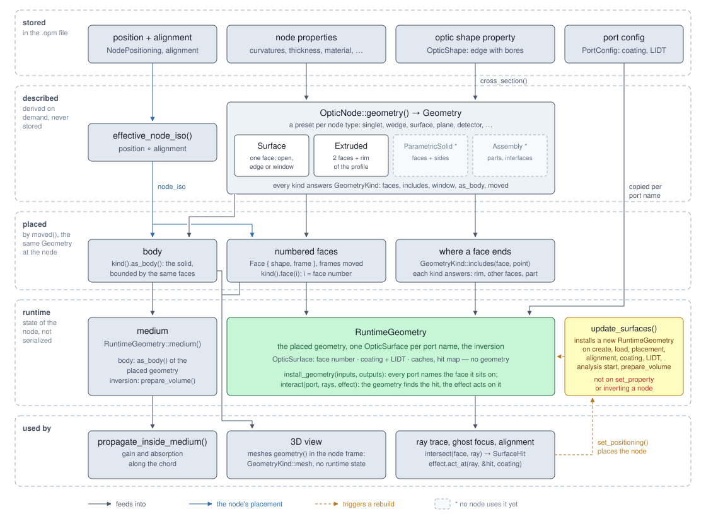

# Component geometry

This page follows the shape of a component from the properties a user enters to the surfaces rays are traced at. It
is written for developers. The first part explains the concepts. The second part follows two components through the
code from start to end, and the last part lists where to change what.

For how components are placed along the optical axis, see [Model geometry](../geometry.md). For what the optic shape
means to a user, see [Optic shape](../../reference/nodes.md#optic-shape).

## Part 1: Concepts

### Three stages

The shape of a component passes three stages:

1. **Describe.** The node derives a *geometry* from its properties: curvatures, thickness, optic shape and so on.
   The geometry is never stored. It is derived again whenever it is needed, so it cannot fall out of step with the
   properties. The node type acts as a preset: a lens is a *singlet* whose parameters are the properties of the
   lens.
2. **Build.** The geometry and the node's *placement* (where it sits and how it is turned) together yield, in one
   step, the objects the simulation works with:
   - the *surfaces* rays are intersected with,
   - the *rim* that bounds them sideways,
   - for a component with a volume, the *body* of material between its surfaces. The body does not get surfaces
     of its own; it is bounded by the very surfaces rays are traced at.
3. **Use.** The analyzers, the alignment run and the 3D view work with these objects. While tracing, a node finds a
   surface by the name of the port the light arrives at or leaves through.

All three are built from one description: the surface a ray hits, the edge that decides whether it hits, and the
medium a gain model acts in. They therefore cannot disagree.

The chart shows what depends on what. It runs from what the `.opm` file stores at the top to what uses the result at
the bottom; the rest of this page explains each box.



### Surface or solid

The first thing a geometry states is whether the component is a single surface or encloses a volume:

- A **surface** has no thickness: a thin mirror, a grating, a filter, a detector.
- A **solid** encloses material between its surfaces: a lens, a wedge.

Separate from its geometry, a node declares *capabilities*:

- **Volumetric**: the node has a medium, with a material, absorption and possibly gain, and is drawn as a body.
- **Planar**: the node is drawn as a single surface of a given kind (reflective, transmissive, detector).

The two answers go together but are not the same question. Some nodes are traced at a plane but are neither planar
nor volumetric, so they are not drawn at all.

| Group | Nodes | Geometry preset | Capability |
|---|---|---|---|
| Volume components | lens, cylindric lens, wedge | `singlet`, `cylindrical_singlet`, `wedge` (all extruded solids) | Volumetric |
| Surface components | mirror, parabolic mirror | `surface` | Planar |
| | grating, beam splitter, ideal filter, paraxial surface | `plane` | Planar |
| | energy meter, fluence detector, spectrometer, spot diagram, wavefront monitor | `detector` | Planar |
| Traced, not drawn | source, dummy, ray propagation visualizer | `plane` | none |
| No shape of its own | group, reference | none | none |

Every node type has to state its geometry: the compiler forces it. Nothing ties the capability to the kind of
geometry, though. A volumetric node has to describe a solid, otherwise deriving its body fails at run time.

### Three kinds of solid

- **Extruded.** Two faces cap a profile that is extruded along an axis. The profile is the optic shape. The center
  thickness is not stored separately: it is where the vertex of the rear face sits, together with any tilt of that
  face (a wedge). Lens, cylindric lens and wedge are extruded solids.
- **Parametric solid.** The intersection of the inner sides of several faces. Built from flat faces only, it is
  always convex: prisms, corner cubes, roof prisms. Curved faces whose inner side is their outside also allow concave
  shapes.
- **Assembly.** Several solids (*parts*), each with its own placement and material, joined by *interfaces*. An
  interface is a pair of faces of different parts that lie on each other, such as the cemented surface of a doublet
  or the diagonal of a beam splitter cube. An assembly is checked when it is created:
  - no part is itself an assembly,
  - an interface joins two different parts,
  - the faces it refers to exist,
  - they are the same surface at the same place,
  - the two parts lie on opposite sides of it.

Only surfaces and extruded solids can be traced. Parametric solids and assemblies are a data model only: everything
that would have to trace them returns an error saying that they are not supported yet. No node type uses them so far.
They are described already so that the data model is settled before the first component needs them.

### Faces, optic shape and rim

- A **face** describes one optical surface: its *surface shape* (plane, sphere, cylinder or parabola) and where its
  vertex sits. It is stated relative to the component, so it can be compared, stored and placed again wherever the
  component moves.
- The **optic shape** is the property that states how far the component reaches sideways: an edge with bores
  through it. The geometry works with it as a *cross section*, a region in the plane perpendicular to the axis of
  the component. An open optic shape has no cross section, and the component is unbounded.
- A **rim** places the cross section in space. It holds:
  - the cross section,
  - the axis the cross section is extruded along,
  - a *role*: an **edge** means the component ends there, so a ray outside misses it. A **window** (detectors only)
    lets all light pass but records only the light inside it.

A curved face has to reach the edge of its cross section. A sphere or a cylinder ends at its radius of curvature, so
a radius smaller than the largest distance of the edge from the axis is rejected when the geometry is derived. A
hemisphere is still allowed.

### Ports and surfaces

Ports belong to the graph. Edges connect them, and each port carries a coating and a laser-induced damage threshold
(LIDT). Ports hold no geometry and no aperture.

The surfaces that are traced are runtime state of the node. A node keeps one *optic surface* per port name. It
consists of:

- the built geometric surface and its anchor,
- the rim,
- the coating and the LIDT, copied from the port of the same name,
- per-surface caches and a hit map.

These are not written to the `.opm` file; they are built again after loading.

The node decides which surface goes under which port. The entrance surface goes under every input port, the exit
surface under every output port. A single surface is entrance and exit at once, so all ports of a mirror or a beam
splitter share one geometric surface. Each port still has its own optic surface with its own coating.

### Surfaces in the sequential trace

The analyzers trace the graph node by node. The analysis of a node receives the light per input port and addresses
surfaces by port name: the name of a surface *is* the name of its port. A lens traces its rays in through the surface
under its input port and out through the surface under its output port.

Inverting a node rebuilds nothing; ghost focus analysis does this on every second pass. The ports of the node swap
inputs and outputs, so the same lookup returns the rear surface first. The geometry stays as it physically is; only
the direction light takes through it changes.

Whether a ray hits a component is decided in exactly one place, by the rim. The optic surfaces ask it when a ray is
intersected with them, and the body of a volume node asks it when it measures how far a ray travels through it. The
point has to meet two conditions:

- it lies within the rim, measured along the rim's axis;
- on a closed surface such as a sphere, it lies on the part that contains the vertex. A ray that reaches a sphere
  only behind its equator misses.

What happens to a ray that misses is decided by the analyzer's missed-surface strategy, not by the surface:

- `Stop`: the ray is lost.
- `Ignore`: the ray passes unchanged.

The alignment run always uses `Stop`.

### When surfaces are rebuilt

Surfaces are never moved. They are built anew from the geometry at the node's current placement. A rebuild replaces the
geometric surface, the anchor and the rim of each existing optic surface but keeps the optic surface itself, so its
caches and hit map survive. For a volume node it also builds the body anew from the new surfaces; the body's
inversion stays empty until the medium is prepared for an analysis.

| Event | Rebuilds the surfaces |
|---|---|
| Creating a node (`Default`, `new`) | yes |
| Loading an `.opm` file | yes |
| Placing the node (alignment run, absolute position) | yes |
| Changing the alignment (decenter, tilt) | yes |
| Changing the coating or LIDT of a port | yes |
| Start of a ray-trace or ghost-focus analysis | yes, for every node |
| Preparing the medium of a volume node | yes |
| Changing any other property (curvature, thickness, optic shape, ...) | **no** |
| Inverting a node | no, nothing to rebuild |

A property change does not rebuild anything. For that reason, every analysis that traces rays first rebuilds all
surfaces. The 3D view does not depend on the rebuilt surfaces at all: it builds what it draws from the geometry at
the node's current placement.

## Part 2: In the code

All paths are relative to `opossum_core/src` unless stated otherwise.

### The types

| Type | File | Role |
|---|---|---|
| `Geometry`, `SurfaceGeometry`, `Solid`, `Extruded`, `ParametricSolid`, `Assembly`, `Part`, `Interface` | `geometry/node_geometry.rs` | the description |
| `PlacedGeometry` | `geometry/node_geometry.rs` | the description built at a placement: entrance, exit, rim and body |
| `Face`, `SurfaceShape` | `geometry/face.rs` | one surface, described |
| `OpticShape`, `Outline`, `Bore` | `apertures/optic_shape.rs` | value of the `optic shape` property |
| `ValidatedCrossSection` | `types/validated_type_definitions.rs` | an aperture that delimits a region |
| `Rim`, `RimRole` | `geometry/rim.rs` | lateral boundary, edge or window |
| `GeoSurface`, `GeoSurfaceRef` | `geometry/geo_surface.rs` (implemented by `Plane`, `Sphere`, `Cylinder`, `Parabola`) | unbounded surface placed in the world, never changed once built, shared as `Arc<..>` |
| `SurfaceBoundedBody`, `Body` | `geometry/body/mod.rs` | the volume between entrance and exit |
| `OpticSurface` | `core_optics/optic_surface.rs` | the runtime surface |
| `RuntimeSurfaces`, `RuntimeMedium` | `core_optics/node_attr.rs` | where a node keeps them, `#[serde(skip)]` |
| `OpticPorts`, `PortConfig` | `core_optics/optic_ports.rs` | coating and LIDT per port |
| `Volumetric`, `Planar` | `core_optics/volumetric.rs`, `core_optics/planar.rs` | the capabilities |

### Example 1: a plano-convex lens

The setup is a source, then a lens 100 mm further on:

- front curvature 50 mm,
- rear curvature infinite (flat),
- center thickness 5 mm,
- the default optic shape, a circle of 12.5 mm radius.

Light runs along +z.

**Step 1: describe.**

1. `Lens::geometry` (`nodes/lens/mod.rs`) reads the three properties.
2. It asks `OpticNodeExt::cross_section` (`core_optics/optic_node_ext.rs`) for the cross section of the optic shape.
   An open optic shape has none, and `Lens::geometry` refuses it, since the medium would be unbounded.
3. It returns `Geometry::singlet(50 mm, ∞, 5 mm, circle)`.

`Geometry::singlet` hands this on to `Geometry::two_faced` as:

- front shape `SurfaceShape::spherical(50 mm)`, which is a `Sphere`,
- rear shape `spherical(∞)`, which is a `Plane`,
- the rear vertex `Isometry::new_along_z(5 mm)`.

`two_faced` builds `Extruded::new(axis = identity, front = Face(Sphere, identity), rear = Face(Plane, z = 5 mm),
circle)`.

`Extruded::new` checks the reach of both faces: the circle reaches 12.5 mm from the axis, and the sphere reaches
50 mm. A front curvature of 10 mm would be refused with "the front face does not reach the edge of its optic shape,
12.500 mm from the axis: its radius of curvature is smaller".

**Step 2: place.** `RayTracingAnalyzer::analyze` (`analyzers/raytrace.rs`) first calls `NodeGroup::rebuild_surfaces`.
It then calls `calc_node_positions` with `RayTraceConfig::for_positioning`. For the lens,
`OpticGraph::set_node_isometry` (`nodes/node_group/optic_graph/analysis.rs`) does the following:

1. It propagates the axis ray by the 100 mm of the connection.
2. It turns the ray into a frame, `world_frame`.
3. It computes `node_iso = world_frame ∘ entrance_frame⁻¹`. The entrance frame
   (`AnalysisRayTrace::axis_entrance_frame`) is the identity for every node except the second input of a beam
   splitter. Here `node_iso` is therefore a translation by (0, 0, 100 mm).
4. It stores the result through `OpticNode::set_positioning(NodePositioning::Automatic(..))`, which calls
   `update_surfaces`.

The origin of the node, its anchor point, is the vertex of the front face.

**Step 3: build.** `Lens::update_surfaces` is a single line: `self.install_geometry(&["input_1"], &["output_1"])`.
`OpticNodeExt::install_geometry` (`core_optics/optic_node_ext.rs`) does the following:

1. It calls `geometry()` again, so it works from the properties as they are now.
2. It takes `effective_node_iso()`, which is the position followed by the alignment, or the identity for a node that
   has not been placed.
3. `Geometry::place(&node_iso)` calls `Extruded::place`, which calls `Face::place` for front and rear and builds the
   body between them from the same two surfaces. The result, a `PlacedGeometry`, also holds the rim
   `Rim::new(circle, identity, RimRole::Edge)`.
4. It calls `update_surface` once per port name.
5. It stores the body as the node's `RuntimeMedium`, with an empty inversion (`NodeAttr::set_runtime_body`).

`Face::place(node_frame, owner)` computes `anchor = owner ∘ vertex ∘ vertex_to_frame` and builds the geometric
surface at `node_frame ∘ anchor`. A sphere or a cylinder has its own frame at its center of curvature, one radius
behind the vertex; a plane or a parabola has it at the vertex.

| Face | vertex | vertex to frame | anchor | frame of the geometric surface |
|---|---|---|---|---|
| front, sphere R = 50 mm | identity | +50 mm along z | z = 50 mm | (0, 0, 150 mm) |
| rear, plane | z = 5 mm | identity | z = 5 mm | (0, 0, 105 mm) |

`update_surface` looks up the `PortConfig` of the port with the same name and adds the port if it is missing. It then
either updates the existing `OpticSurface` in place or inserts a new one into `runtime_surfaces.inputs` or
`runtime_surfaces.outputs`:

```text
runtime_surfaces.inputs ["input_1"]  = OpticSurface { Sphere at z = 150 mm, anchor z = 50 mm, rim, coating + LIDT of input_1 }
runtime_surfaces.outputs["output_1"] = OpticSurface { Plane  at z = 105 mm, anchor z = 5 mm,  rim, coating + LIDT of output_1 }
```

The rim stores no world frame. An optic surface recovers the node frame from where its geometric surface sits: the
isometry of that surface followed by the inverse of its anchor (`OpticSurface::node_frame`). For both surfaces this is
(0, 0, 100 mm).

**Step 4: the medium.** After the alignment run the analyzer calls `reset_data` and then `OpticNode::prepare_volume`.
For a volume node, `prepare_volume` does the following:

1. It calls `update_surfaces` once more, which rebuilds the surfaces and the body as in Step 3.
2. If the gain model reads an inversion, it builds one in the body of the `RuntimeMedium`
   (`Extraction::build_inversion`).

The body, `SurfaceBoundedBody::new(front, rear, circle, node_iso ∘ axis)`, is bounded by the very surfaces light is
traced at: its entrance is the sphere under `input_1`, its exit the plane under `output_1`. It knows no port names.
`Volumetric::volume_body` builds the same body anew from the current properties; the 3D view uses it, an analysis
does not.

**Step 5: trace.** `OpticGraph::analyze_raytrace` (`nodes/node_group/optic_graph/raytrace.rs`) walks the graph and
hands each node the light that arrives at its ports. `Lens::analyze` (`nodes/lens/analysis_raytrace.rs`) calls
`Volumetric::unified_analyze_volume_node`, which does two things:

1. `single_io_port_names(self)` returns `("input_1", "output_1")`. It takes them from `self.ports()`, which accounts
   for inversion.
2. `Volumetric::pass_through_volume_generic("input_1", "output_1", ..)` runs three steps:
   1. `pass_through_surface_generic("input_1", index of the material, ..)` follows this chain:
      `get_optic_surface_mut("input_1")` → `OpticSurface::propagate_rays` → `Rays::refract_on_surface` →
      `Ray::refract_on_surface_with_coating` → `OpticSurface::intersect`.
   2. `propagate_inside_medium` applies gain and absorption along the chord through the body of the
      `RuntimeMedium`. It does not move the rays.
   3. `pass_through_surface_generic("output_1", ambient index, ..)` runs the same chain at the rear plane.

`OpticSurface::intersect` hands an edge rim to `Rim::intersect` (`geometry/rim.rs`), where hit or miss is decided:

1. `GeoSurface::calc_intersect_and_normal` intersects the ray with the unbounded surface.
2. The point counts only if `Rim::contains(point, node_frame)` and `GeoSurface::is_on_vertex_sheet(point)` both
   hold.

`SurfaceBoundedBody::path_length_inside` decides the same way when it measures the chord through the body.

A ray parallel to the axis at y = 13 mm meets the sphere, but outside the 12.5 mm circle, so it misses. With `Stop`,
`Ray::refract_on_surface_with_coating` invalidates it; with `Ignore`, it stays unchanged. `propagate_rays` reports
per ray whether it hit, so later steps act only on hits: the attenuation of an ideal filter, the deflection of a
paraxial surface.

**Variations.**

- *Inverted lens.* On every second ghost-focus pass the whole scenery is inverted. Nothing is rebuilt:
  - `ports()` swaps, so `single_io_port_names` returns `("output_1", "input_1")`.
  - `pass_through_volume_generic` passes `backward = self.inverted()`, and the rear plane is traced first.
  - The body stays the same.
- *Changed property.* After `set_property("center thickness", ..)` the description changes at once. The runtime
  surfaces, and the body of the medium with them, stay stale until the next rebuild: at the start of an analysis,
  or through an explicit `update_surfaces`. `volume_body` and `Planar::surface_mesh` are always current, since they
  build the shape from `geometry()` directly.

### Example 2: a flat mirror tilted by 45°

The setup is a source, then a thin mirror 100 mm further on:

- curvature infinite (flat),
- the default optic shape,
- an alignment tilt of 45° about x, which turns the beam by 90°.

**Describe.** `ThinMirror::geometry` (`nodes/thin_mirror.rs`) returns
`Geometry::surface(identity, SurfaceShape::spherical(∞), identity, Some(circle))`. The shape `spherical(∞)` is a
`Plane`, and the result is `SurfaceGeometry::new(axis, Face(Plane, identity), circle, RimRole::Edge)`. Its reach check
always passes, since a plane reaches any edge.

**Place and build.**

1. The mirror is placed as in the lens example, at a translation by (0, 0, 100 mm).
2. `effective_node_iso` is that position followed by the alignment: the translation, then 45° about x.
3. `ThinMirror::update_surfaces` calls `install_geometry(&["input_1"], &["output_1"])`.
4. For a surface, `Geometry::place` calls `SurfaceGeometry::place`, which places the face once and uses it as entrance
   and exit. `input_1` and `output_1` therefore get separate `OpticSurface`s that share one `GeoSurfaceRef`, the same
   `Arc`. A surface encloses no volume, so the mirror gets no medium.
5. `ThinMirror::default` gives both ports a 100 % `ConstantR` coating through `set_coating`, which rebuilds as well.

**Trace.** `ThinMirror::analyze` (the `AnalysisRayTrace` implementation in `nodes/thin_mirror.rs`) uses neither the
volume helper nor the single-surface helper:

1. It takes the first input and output names from `self.ports()`.
2. It looks up `get_optic_surface_mut(in_port)`.
3. It calls `Rays::refract_on_surface(surf, None, refraction_intended = false, missed strategy)` directly.
4. It emits only the reflected bundle at the output port. Outside the alignment run it first drops rays below the
   energy threshold.

A ray that misses the mirror is lost in every analysis, because only reflected light leaves it. In the alignment run
the next node is placed along the reflected axis. If the axis misses the mirror, the run stops with an error that
names the mirror.

**Draw.** The 3D view (`for_each_drawable` in `opossum_backend/src/scene_export.rs`) asks each node `as_volume` and
`as_surface`:

- For the mirror, `Planar::surface_mesh` (`core_optics/planar.rs`) places the geometry itself with
  `Geometry::place` and meshes the entrance surface within the rim.
- A volume node is drawn from `Volumetric::volume_body`, which places the geometry the same way.

Neither reads the runtime surfaces, so a property that was changed without a rebuild is drawn as it is now. The
endpoint for a single component (`opossum_backend/src/document.rs`) therefore meshes the node without rebuilding it.

### Other components

| Node | What differs |
|---|---|
| Parabolic mirror | `Geometry::surface` with an axis other than the identity. The node sits where the chief ray hits the mirror. `calc_off_axis_frames` returns two frames: the frame of the parent parabola's axis through the node, in which the optic shape is measured, and the vertex of the parent parabola, stated in that frame. |
| Beam splitter | One plane under four port names: `install_geometry(&["input_1", "input_2"], &["out1_trans1_refl2", "out2_trans2_refl1"])`. Its analysis addresses the ports by name itself. The second input enters mirrored on the plane (`axis_entrance_frame`). |
| Detectors | `Geometry::detector` gives a rim whose role is a window. `OpticSurface::intersect` ignores it, so all light passes. `OpticSurface::records_at` and `clip_to_window` decide what is recorded. With an open optic shape there is no rim, and everything is recorded. |
| Ideal filter, paraxial surface | `Geometry::plane`. Both use the per-ray hits of `propagate_rays`, so only rays that hit are attenuated or deflected. The paraxial surface may be unbounded. |
| Source, dummy, ray propagation visualizer | `Geometry::plane`. Source and visualizer are unbounded. A dummy is bounded only if it is given an optic shape, and then acts as an iris. None of them is planar, so none is drawn. A source installs only `output_1`. |
| Group, reference | `geometry()` returns `None`, and `update_surfaces` does nothing. The nodes inside a group have their own geometry. A reference is traced through the node it refers to. |

### One analysis run, in order

A ray-tracing analysis (`RayTracingAnalyzer::analyze`) runs these steps:

1. `NodeGroup::rebuild_surfaces` calls `update_surfaces` on every node, recursing into groups, so the trace sees the
   properties as they are now.
2. `calc_node_positions` runs with `RayTraceConfig::for_positioning`:
   - the missed-surface strategy is fixed to `Stop`;
   - `positioning_run` is true, so there is no energy threshold and no medium;
   - every node that gets placed rebuilds its surfaces through `set_positioning`;
   - if the axis ray leaves a node invalid and the node has successors, the run stops with an error naming the node.
3. `reset_data` clears light data, the caches and hit maps of the optic surfaces, and the inversion.
4. `prepare_volume` makes the volume nodes rebuild their surfaces and bodies, and builds the inversion where the gain
   model needs one (see Example 1, Step 4).
5. `AnalysisRayTrace::analyze` performs the trace itself.

A ghost-focus analysis (`GhostFocusAnalyzer::analyze`, `analyzers/ghostfocus/analyzer.rs`) runs the same first four
steps. Its alignment run uses `AnalyzerType::positioning_config`: a plain ray-trace configuration with the
analysis's sources. Then the bounce passes follow:

- Even passes run forward.
- Odd passes run with the scenery inverted. `OpticGraph::analyze_ghostfocus` then reverses the graph for the pass
  through an `InvertGraphGuard`. Surfaces are not rebuilt.
- A ghost reflected in one pass is cached on the optic surface it came from and re-enters at that surface in the
  next pass.

## Part 3: Where to change what

- **A new node type.**
  - Implement `OpticNode::geometry` with a preset. The method has no default, so the compiler forces an answer;
    `None` is the answer for a node without a shape of its own.
  - Implement `update_surfaces` as `install_geometry` with the port names of the node, and call it in `Default`.
  - Declare the `OPTIC_SHAPE` property in `Default`, as `ThinMirror::default` does.
  - Declare the capability: `Volumetric` and `as_volume` for a solid with a material, or `Planar`, `as_surface` and
    `surface_kind` for a surface that is drawn.
- **A new preset**, such as another kind of lens: add a constructor on `Geometry` next to `singlet` that builds an
  `Extruded` or a `SurfaceGeometry`. Nothing downstream changes.
- **A new surface shape.**
  - Add a variant to `SurfaceShape` in `geometry/face.rs`. The compiler then points at `matches`, `reaches`,
    `depends_on_roll`, `vertex_to_frame` and `build`.
  - Add a `GeoSurface` implementation in `geometry/`, like `Sphere`. Its `local_z_at` has to describe the sheet
    through the vertex: `is_on_vertex_sheet`, and with it every hit test, is derived from it.
- **Tracing a parametric solid or an assembly.**
  - `install_geometry` knows exactly one entrance surface and one exit surface.
  - `Geometry::place` ends in `not_supported_yet` for these two kinds.

  A tracer for them has to replace that branch and the entrance/exit assumption.
- **Who reads what.**
  - Read the geometry directly: `install_geometry`, and the 3D view through `Volumetric::volume_body` and
    `Planar::surface_mesh`.
  - Read the runtime surfaces and the medium: all analyzers and `OpticNodeExt::effective_surface_iso` (used by the
    paraxial surface).
  - `install_geometry` and `update_surface` are the only place that builds runtime surfaces and the runtime body.
