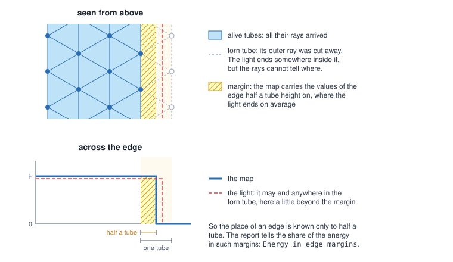
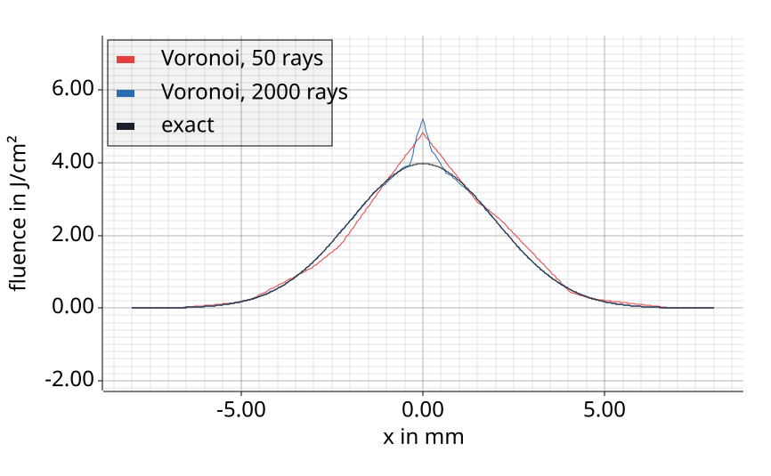
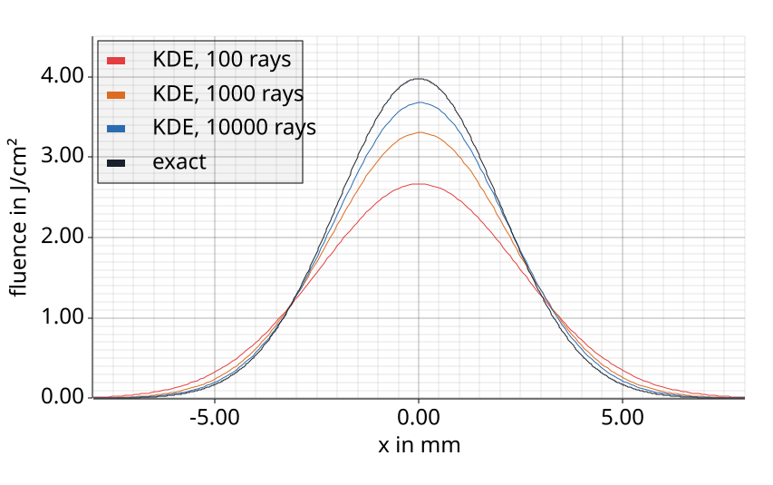
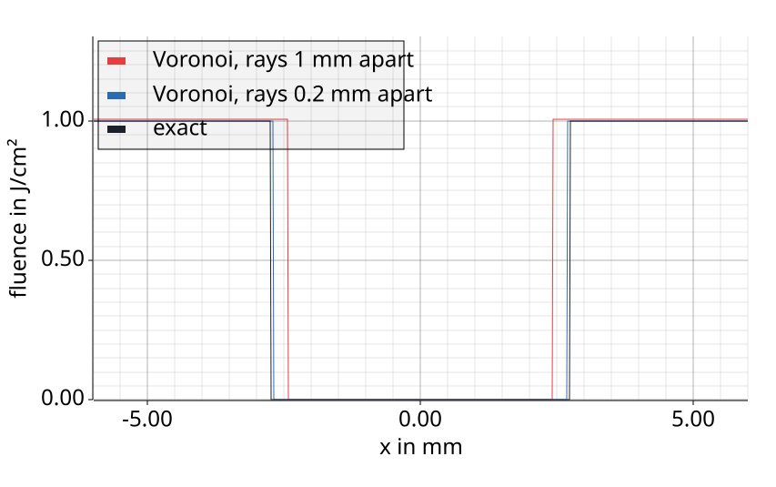
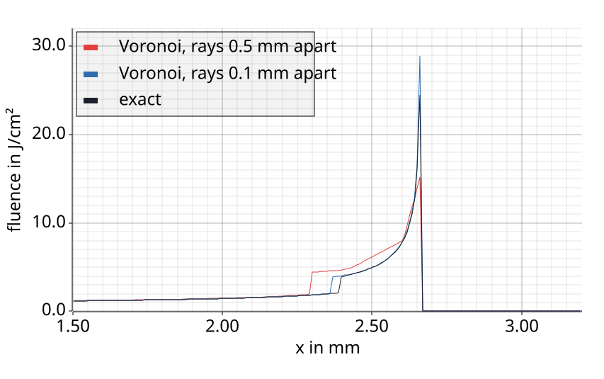

## Fluence 

In OPOSSUM, fluence describes the spatial distribution of optical energy deposited on a detector surface. It represents energy per unit area after the optical system has transformed the incoming beam.

Since ray tracing represents light using a finite number of rays, fluence must be reconstructed from discrete energy samples. Each ray carries a portion of energy and contributes to the detector at its intersection point. The reconstruction method defines how these discrete contributions are converted into a continuous fluence map.

This step is essential because quantities such as peak fluence, beam shape, and local intensity cannot be interpreted reliably from raw ray positions alone.

## Why Reconstruction is Needed

A straightforward approach is to divide the detector into a fixed grid and accumulate ray energy per cell. However, this introduces limitations. If the grid is too coarse, peak fluence is underestimated because energy is averaged over large areas. If the grid is too fine, the result becomes noisy unless a very large number of rays is used.

This creates a trade-off between spatial resolution and statistical stability. To address this, OPOSSUM provides multiple reconstruction methods that interpret the same ray data in different ways.

## Binning

The binning method spans a regular grid of points over the detector. A ray rarely lands on a point; it spreads its energy over the four points around it, the nearer a point the more: a ray 30 % of the way from one point to the next gives 70 % to the first and 30 % to the second. Each point shows the energy it got over the area it stands for, the cell around it, so the map holds the energy of all the rays within it.

This method behaves like a pixelated representation of the detector. It is simple and computationally efficient, and spreading a ray over four points keeps a ray that crosses a cell border from making the map jump.

However, the result strongly depends on grid resolution. A coarse grid smooths out details and can hide peak fluence regions, while a fine grid requires a high number of rays to avoid noise. As a result, binning is often used for fast but lower-resolution analysis.

## Fluence from ray tubes

The Voronoi estimator follows the light from where it starts. At the source, every three neighboring rays span a triangle, a *ray tube*. The light inside a tube stays inside it: wherever its three rays go, the tube goes with them, stretched, shrunk or turned over.

On a surface, a tube is *alive* if all three of its rays arrived there. The map is drawn over the alive tubes only. A bore, an edge or an aperture that cuts the light tears the tubes across the cut: their rays arrive on different surfaces, and neither surface draws them. So where light was cut away, the map stays dark.

*The rays inside the bore pass it, the others are reflected. Each surface draws the tubes whose three rays all arrived there; the tubes across the edge of the bore are torn and drawn on neither.*

### The value at a corner

The Voronoi estimator spreads the energy `E` that the rays of a corner bring over the area `A_src` the corner stands for at the source: its Voronoi cell there, which gives the estimator its name. On the way, that area grows as much as the alive tubes around the corner grew:

`F = E / A_src · D_src / D_det`

where `D_src` and `D_det` are the areas of the alive tubes around the corner at the source and on the surface. A tube torn away counts on neither side, so a corner right next to a cut shows the fluence of the light that is there.

So that `E / A_src` shows the light the source describes, a source that samples a distribution, a Gaussian for instance, gives each ray in an analysis the value of the distribution where it lies times the area it stands for. A ray that stands for less area, as the one in the middle of a hexapolar pattern, carries less energy. Raw rays keep the energies they were given, and light that is only drawn in the 3D view is sent out with equal shares.

*`D_det / D_src` says how much the light around the corner spread out on its way.*

Between its corners a tube runs linearly. Where tubes overlap, their values add up: two beams crossing each other, or light that folds over itself (see [Folds and caustics](#folds-and-caustics)).

### Edges

Beyond each edge that no alive tube continues, the map draws a margin of half a tube height, carrying the values of the edge across: the light ends somewhere inside the torn tube, halfway on average. The same rule holds at the outer edge of a beam and at a cut. Where the margins of two edges meet at a corner, both end on the bisector of that corner, as picture frames are mitered: at the edge of a hole they do not overlap, and at an outer corner they leave no gap. The area each ray stands for at the source follows the same rule. Rays along a straight edge, as of a grid that is turned or sent out from a point, often lie on one line only up to rounding; the flat triangles between them are no tubes, so the edge keeps its margin. Unless a range is given, the map is square, centered on the light and 5 % wider than its longer side, so the edges of the light lie inside the map rather than on its outermost points.

*The rays of the right column were cut away. The light ends somewhere in the torn tubes before them; the map assumes halfway and carries the edge values that far.*

Where an edge lies is therefore known only to half a tube. The report of a [fluence detector](../reference/nodes/fluence_detector.md) tells which share of the energy lies in these margins (`Energy in edge margins`). A large share means that the rays are too coarse for the edges of the light.

### Why the hits alone are not enough

A map built from the hits alone does not know which hits belonged together. A triangulation of the hits spans any hole between them, and the Voronoi cell of a hit next to a hole reaches into the hole. The map fills the hole with light, and next to it shows too little fluence, as the energy of the edge rays is spread over too large an area. The ray tubes know from the source which rays are neighbors, so a hole stays a hole.

### Sheets

Rays of one wavelength that start side by side form one *sheet*, triangulated by where they start. Rays that start at one point in different directions, as from a point source or from one pixel of an image source, form a sheet of their own, triangulated by their directions. Rays of different wavelengths never share a tube. Each sheet draws its own tubes, and the map is their sum.

### Folds and caustics

Near a caustic, light folds over itself: rays from one side of the beam cross rays from the other side, and the tubes beyond the crossing arrive turned over. Both layers of the light are drawn, and where they lie on top of each other their fluences add. At the fold itself, geometric optics fails: the fluence there would grow without bound, and the map cannot show its true value. The map then warns: "light folds over itself on this surface (caustic): the fluence near the fold is unreliable".

Light that turns over as a whole does not fold. Behind a clean focus, or after a mirror, every tube arrives turned over alike, and there is no warning. A tube squashed flat, as at a line focus, counts as neither turned nor kept, since rounding decides its side.

### When the tubes are built

A source spans the tubes only when an analysis needs them, since building them costs time and memory:

- a ghost focus analysis with the Voronoi estimator, and
- a ray tracing or ghost focus analysis whose model holds a fluence detector with this estimator, also inside a group.

The tubes are built on whatever the source sends out, raw rays included. The alignment run and the 3D view never build them.

### Limits

- A hole smaller than about two ray spacings is not resolved: no tube tears across it.
- A bundle with a gap already at the source, such as raw rays laid out as a ring, is bridged there: its tubes span the gap from the start.
- A ray all of whose tubes tore, such as a single stray ray, shows nowhere on the map.

## KDE (Kernel Density Estimation)

The KDE method reconstructs fluence by treating each ray as a smooth energy distribution rather than a single point. Instead of assigning energy to a single location or cell, each ray spreads its energy over a surrounding area using a smooth kernel function.

The final fluence map is obtained by summing the contributions of all rays, resulting in a continuous and smooth intensity field.

The smoothing strength is controlled by the kernel width. If the width is too small, the result becomes noisy and resembles raw sampling. If it is too large, fine spatial details are lost and peak fluence can be reduced.

To balance this, the kernel width is chosen by an established statistical rule from the spread and the number of the hits; it cannot be set by hand. The rule errs on the smooth side: with few rays the kernel is wide, and the peak comes out low (see [Peak Fluence and Interpretation](#peak-fluence-and-interpretation)).

This method provides the smoothest representation of fluence and is especially useful when a continuous interpretation of the beam profile is required.

## Peak Fluence and Interpretation

Peak fluence represents the maximum energy concentration on the detector surface and is one of the most important quantities in optical system analysis.

It is sensitive to both sampling density and reconstruction method. The cuts below show where it goes well and where it goes wrong. Each is a cut along x through a map that OPOSSUM computes, next to the exact fluence; the example `opossum_reporter/examples/fluence_peak_examples.rs` makes them.

### Too few rays

*A Gaussian beam with σ = 2 mm, its peak 1 mm off the axis. With 50 rays the peak falls between rays and comes out 7 % low and 0.5 mm off. Adding the deviation the map estimates from the curvature brings it to 4 % low and 0.1 mm off; at the outermost tube, near 7.5 mm, the estimate overshoots. With 2000 rays the map is right.*

A map that follows ray tubes knows the fluence at its rays and runs linearly between them. A peak that falls between two rays is cut off. The rays need to lie closer than the features of the light are wide, above all where the peak is. How far the peak of the fluence may lie above the peak of the map, the report estimates from the curvature of the fluence (see [Uncertainty](#uncertainty)).

### Binning: the grid

*The same beam of 10000 rays, binned on 9 × 9, 41 × 41 and 301 × 301 points. Too coarse, a point averages over the peak, which comes out 16 % low. Too fine, too few rays fall near a point, and the map turns into noise with spikes far above the peak. In between, the peak is right.*

As a rule of thumb, some ten rays or more should fall into each cell of the grid.

### KDE: the kernel

*The same beam by KDE, from 100, 1000 and 10000 rays. The kernel follows the spread of the hits, which is that of the whole beam, and narrows only slowly with more rays: the peak comes out 33 %, 17 % and 8 % low.*

KDE never shows noise, and its peak is a lower bound. A small hot spot in a large beam suffers most, as the kernel is set by the large beam.

### At an edge

*A flat-top beam of 1 J/cm² with a bore of 2.75 mm radius. The map shows the full fluence right up to the edge of the bore, which it places within half a ray spacing: at 2.5 mm with rays 1 mm apart, at 2.7 mm with rays 0.2 mm apart.*

At a cut, the peak is right, but where the light ends is known only to half a tube (see [Edges](#edges)); the report tells how much energy lies in that uncertain margin.

### At a fold

*Light folded over itself, as near a caustic: every ray moved from x to x − x³/48 (in mm), which folds the light back at 2.67 mm. From 2.4 mm on a second layer of light lies on the first, and both maps add the two up; the coarse one starts the second layer half a ray spacing early. At the fold the exact fluence grows without bound, and the peak of the map is set by the rays: 15 J/cm² with rays 0.5 mm apart, 29 J/cm² with rays 0.1 mm apart.*

Near a fold, more rays do not bring the peak closer to a true value, because in geometric optics there is none: diffraction limits it, which ray tracing does not know. The map warns when light folds over itself (see [Folds and caustics](#folds-and-caustics)).

### Energy

The methods do not hold the same energy either. Binning and KDE spread the energy of every ray that hit the surface. A map that follows ray tubes holds the energy of the tubes that arrived complete and of their margins: the margins estimate where the light ends, and a ray all of whose tubes tore shows nowhere. Between its rays such a map runs linearly, so a curved profile sampled by few rays holds slightly more or less energy than its rays brought: a Gaussian sampled 0.57 σ apart about 0.2 % more (see [Too few rays](#too-few-rays)).

The report of a fluence detector therefore tells the energy that hit it, whatever the estimator, and for Voronoi how far the energy of the map misses it (see [Fluence detector](../reference/nodes/fluence_detector.md)).

For this reason, fluence reconstruction should always be interpreted together with ray density and system geometry.

### Uncertainty

For the Voronoi estimator, the report of a fluence detector estimates how far the fluence may lie from the map between the rays. `Fluence uncertainty` is a map of the size of the estimated deviation at each point, and `Peak fluence uncertainty` tells how far the peak of the fluence may lie above the peak of the map. This section derives both and states exactly what they promise and what they do not.

**Notation.** Let $f$ be the fluence on the surface. An alive tube $T$ has the corners $x_0, x_1, x_2$, the edges $e_{ij} = x_i - x_j$ and the size $h = \max_{i<j} |e_{ij}|$. A point $x$ of $T$ has the barycentric coordinates $\lambda_i \ge 0$ with $\sum_i \lambda_i = 1$ and $\sum_i \lambda_i x_i = x$. In $T$ the map is the linear interpolation $L(x) = \sum_i \lambda_i F_i$ of the values $F_i$ at the corners. $\|D^2 f\|$ and $\|D^3 f\|$ are the largest second and third derivatives of $f$, as the norms of the symmetric bilinear and trilinear forms, over the region in question.

**Assumptions.**

- **A1** On the alive tubes of a sheet, $f$ is three times continuously differentiable.
- **A2** The values at the corners are values of the fluence: $F_i = f(x_i)$. Without optics between the source and the surface this holds exactly, since an analysis gives each ray the value of its source's distribution times the area it stands for (see [The value at a corner](#the-value-at-a-corner)). Behind optics it holds only approximately (see the limits below).
- **A3** The light does not fold over itself on the surface (see [Folds and caustics](#folds-and-caustics)).
- **A4** The light forms one sheet. Overlapping sheets add up point by point, and their estimates with them.

**Theorem 1 (error of the linear interpolation).** Under A1 and A2, for every point $x$ of $T$

$$f(x) - L(x) = -\frac{1}{2}\sum_{i<j}\lambda_i\lambda_j\, e_{ij}^\top D^2 f(x)\, e_{ij} + R(x), \qquad |R(x)| \le \frac{1}{6}\,\|D^3 f\|\,h^3 .$$

*Proof.* Let $y_i = x_i - x$. Taylor's theorem along the segment from $x$ to $x_i$, which lies in $T$, gives $f(x_i) = f(x) + \nabla f(x)\cdot y_i + \frac{1}{2}\,y_i^\top D^2 f(x)\, y_i + r_i$ with $|r_i| \le \frac{1}{6}\|D^3 f\|\,|y_i|^3 \le \frac{1}{6}\|D^3 f\|\,h^3$, since no point of a triangle lies farther than its longest edge from a corner. Weighted by $\lambda_i$ and summed, the first term gives $f(x)$, and the second vanishes because $\sum_i \lambda_i y_i = 0$. For the third, take any symmetric matrix $A$. Since $\sum_i \lambda_i = 1$ and $\sum_i \lambda_i y_i = 0$,

$$\sum_{i,j}\lambda_i\lambda_j\,(y_i - y_j)^\top A\,(y_i - y_j) = 2\sum_i \lambda_i\, y_i^\top A\, y_i - 2\Big(\sum_i \lambda_i y_i\Big)^\top A\,\Big(\sum_j \lambda_j y_j\Big) = 2\sum_i \lambda_i\, y_i^\top A\, y_i ,$$

and since $y_i - y_j = e_{ij}$, the left side is $2\sum_{i<j}\lambda_i\lambda_j\, e_{ij}^\top A\, e_{ij}$. So $L(x) = \sum_i \lambda_i f(x_i) = f(x) + \frac{1}{2}\sum_{i<j}\lambda_i\lambda_j\, e_{ij}^\top D^2 f(x)\, e_{ij} + \sum_i \lambda_i r_i$, which is the statement with $R = -\sum_i \lambda_i r_i$. $\square$

For a quadratic fluence $D^3 f = 0$, so $R = 0$ and the formula is exact.

**Theorem 2 (curvature at a corner).** Let a corner $x_0$ share alive tubes with the neighbors $x_1, \dots, x_m$. Let $d_k = x_k - x_0$, $\Delta_k = F_k - F_0$, $s = \max_k |d_k|$ and $\delta_k = d_k / s$. OPOSSUM fits $\Delta_k \approx g\cdot d_k + \frac{1}{2}\, d_k^\top \hat H\, d_k$ by least squares in five unknowns, the gradient $g$ and the symmetric matrix $\hat H$. The fit has the $m \times 5$ matrix $M$ with the rows $\big(\delta_{k,x},\ \delta_{k,y},\ \frac{1}{2}\delta_{k,x}^2,\ \delta_{k,x}\delta_{k,y},\ \frac{1}{2}\delta_{k,y}^2\big)$, and the unknowns $(s\,g,\ s^2 \hat H_{xx},\ s^2 \hat H_{xy},\ s^2 \hat H_{yy})$. Its solution is unique if $M$ has rank 5, which needs $m \ge 5$. OPOSSUM gives a corner no curvature unless the smallest singular value $\sigma_{\min}$ of $M$ exceeds $10^{-10}$ times the largest. Under A2:

1. If $f$ is quadratic, its gradient and Hessian at $x_0$ fit the $\Delta_k$ without residual, so the unique least-squares solution is exact: $\hat H = D^2 f$.
2. Under A1, the $\Delta_k$ equal $\nabla f(x_0)\cdot d_k + \frac{1}{2}\, d_k^\top D^2 f(x_0)\, d_k + \rho_k$ with $|\rho_k| \le \frac{1}{6}\|D^3 f\|\, s^3$, by Taylor's theorem along the edge from $x_0$ to $x_k$. The least-squares solution is linear in the data, so the error of the fit is the least-squares solution for the $\rho_k$ alone, of length at most $|\rho| / \sigma_{\min} \le \sqrt{m}\,\|D^3 f\|\, s^3 / (6\,\sigma_{\min})$. Dividing by $s^2$, every entry of $\hat H - D^2 f(x_0)$ is at most

$$\frac{\sqrt{m}}{6\,\sigma_{\min}}\,\|D^3 f\|\, s .$$

The factor $\sqrt{m}/(6\,\sigma_{\min})$ depends on the shape of the neighborhood, not on its size.

**The estimate.** In each alive tube $T$, OPOSSUM takes $\hat H_T$, the mean of $\hat H$ over those of its corners that have one, and draws

$$\hat e(x) = -\frac{1}{2}\sum_{i<j}\lambda_i\lambda_j\, e_{ij}^\top \hat H_T\, e_{ij}$$

onto the points of the map, where overlapping tubes add up as in the map. By Theorem 1, and since $\sum_{i<j}\lambda_i\lambda_j \le \frac{1}{3}$ and $|e_{ij}| \le h$,

$$\big|f(x) - L(x) - \hat e(x)\big| \le \frac{h^2}{6}\,\big\|D^2 f(x) - \hat H_T\big\| + \frac{1}{6}\,\|D^3 f\|\,h^3 .$$

At each corner $x_c$ of $T$, $\|D^2 f(x) - D^2 f(x_c)\| \le \|D^3 f\|\,h$, and by Theorem 2 $\|D^2 f(x_c) - \hat H_c\| \le 2\,C\,\|D^3 f\|\,s$, where $C$ is the largest $\sqrt{m}/(6\,\sigma_{\min})$ and $s$ the largest step of the corners of $T$, and the factor 2 turns the bound on the entries of a symmetric $2 \times 2$ matrix into one on its norm. So

$$\big|f(x) - L(x) - \hat e(x)\big| \le \frac{1}{6}\,\|D^3 f\|\,\big(2h^3 + 2\,C\,h^2 s\big) ,$$

of the order $h^3$. The estimate catches the leading part of the deviation, of the order $h^2$; what it misses is one order smaller. For a quadratic fluence it is exact.

**The peak.** Let $P$ be the peak of the map, its highest value over its points $y_k$, spaced $h_r$ apart along both axes. The report gives

$$U = \max\Big(0,\ \max_k \big(L(y_k) + \hat e(y_k)\big) - P\Big).$$

- *The peak of the map does not lie above the peak of the fluence.* Under A2 to A4, every point of the map lies in at most one alive tube or margin, unless a margin reaches across a gap narrower than a tube onto another margin or tube. In a tube the map is an average of corner values, so $L \le \max_i F_i = \max_i f(x_i)$, and a margin carries the values of its edge. Hence $P \le \max f$.
- *The peak of the fluence lies above that of the map by about $U$.* Let the peak of $f$ lie at $x^*$, inside alive tubes that have an estimate and at least $h_r/\sqrt{2}$ from their outer edge, and let $y^*$ be the point of the map nearest to it, so that $|x^* - y^*| \le h_r/\sqrt{2}$ and $y^*$ lies in those tubes too. Since $\nabla f(x^*) = 0$, Taylor's theorem gives $f(x^*) - f(y^*) \le \frac{1}{2}\|D^2 f\|\,|x^* - y^*|^2 \le \frac{1}{4}\|D^2 f\|\,h_r^2$. With the bound $\varepsilon$ of the estimate above, $f(y^*) \le L(y^*) + \hat e(y^*) + \varepsilon \le P + U + \varepsilon$. Together:

$$P \;\le\; \max f \;\le\; P + U + \varepsilon + \tfrac{1}{4}\,\|D^2 f\|\,h_r^2 .$$

$U$ is therefore an estimate, not a bound: the peak of the fluence can lie above $P + U$ by a remainder of the third order in the spacing of the rays and of the second order in the spacing of the map. For a Gaussian beam with σ = 2 mm, sampled by 7 hexapolar rings out to 8 mm, rays about 1.1 mm apart, with its peak 1 mm off the axis, the peak of the map lies 0.187 J/cm² below that of the beam. $U$ = 0.148 J/cm² closes 79 % of the gap; the remaining 0.039 J/cm² is the remainder. Halving the spacing of the rays shrinks the largest deviation of the map within 2σ about fourfold, and what the estimate leaves about eightfold: 0.188, 0.062 and 0.018 J/cm², against 0.040, 0.0044 and 0.0006 J/cm², for 7, 14 and 28 rings.

**Limits.**

- Behind optics, A2 holds only approximately. A corner's value divides by the growth $D_{det}/D_{src}$ of its alive tubes, an average over the tubes around it rather than the magnification at the ray itself. Its error is of the first order in $h$, and of the second where the tubes lie point-symmetrically around the corner. $U$ does not contain it.
- Margins have no estimate: A1 fails there, because the light ends. Where it ends is known to half a tube, which `Energy in edge margins` tells.
- A corner with fewer than five neighbors along alive tubes, or with a fit of rank below five, has no curvature, as on the outermost ring of a beam. Its tubes use the mean over their other corners, which is taken from further inside and can overshoot where the curvature changes fast; the cut in [Too few rays](#too-few-rays) shows this at 7.5 mm. A tube none of whose corners has a curvature has no estimate.
- Where the light folds over itself (A3), where sheets overlap (A4), or where a margin reaches across a gap narrower than a tube, $P \le \max f$ need not hold.
- Nothing finer than the rays is seen. The bounds above are small only if $h\,\|D^3 f\|$ is small against $\|D^2 f\|$, that is if the light changes little from one ray to the next. A structure narrower than the spacing of the rays shows in no estimate built from them.
- The estimate is made for Voronoi maps only; KDE and binning report none.

## Key Takeaways

Fluence reconstruction converts discrete ray energy into a continuous spatial representation.

Binning uses fixed grid cells and is fast but resolution-dependent.

Voronoi follows the ray tubes the source spans: holes and cuts stay dark, overlapping light adds up, and light folding over itself is warned about. An edge is known to half a tube.

KDE produces a smooth continuous distribution by spreading each ray’s energy over space.

A peak is only as good as the rays around it: they must lie closer than the light changes, binning needs enough rays in each cell, the peak of KDE is a lower bound, and at a fold the rays rather than the light set the peak.

For Voronoi, the report estimates from the curvature at the corners how far the fluence deviates from the map between the rays. The estimate catches the deviation up to the third order in the spacing of the rays and is exact for quadratic profiles; it is an estimate, not a bound.

The choice of method affects how clearly peak fluence and spatial energy distribution are represented, especially in systems with focused beams or non-uniform illumination.
