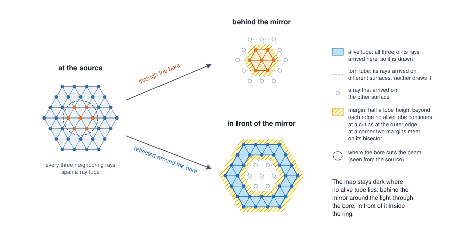
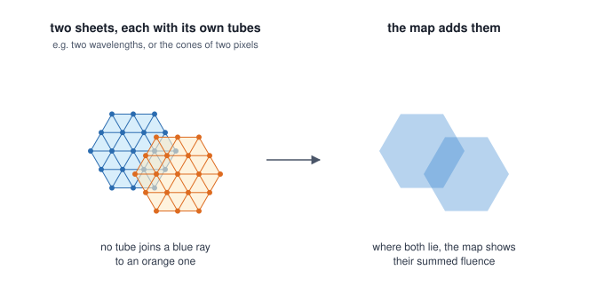
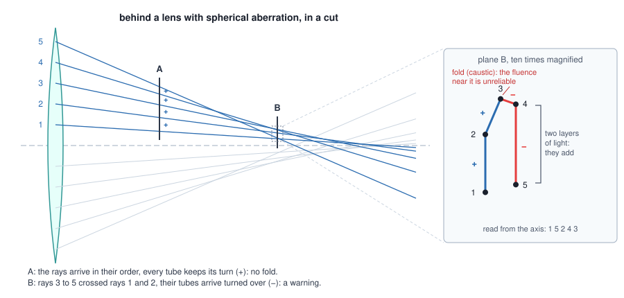
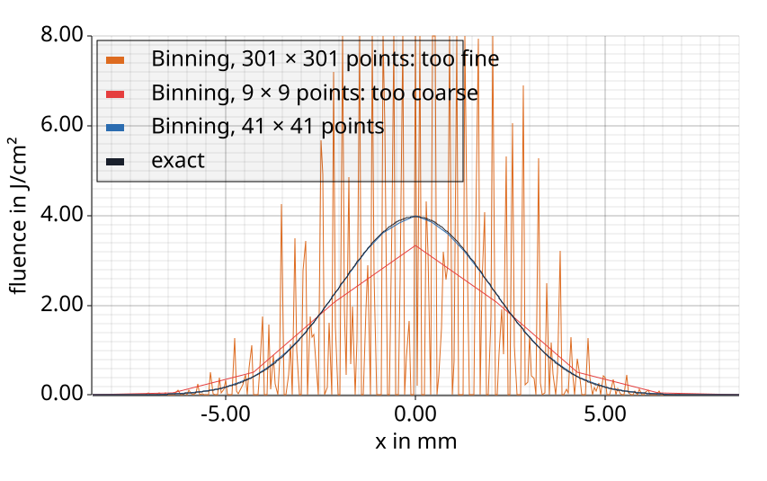

## Fluence 

In OPOSSUM, fluence describes the spatial distribution of optical energy deposited on a detector surface. It represents energy per unit area after the optical system has transformed the incoming beam.

Since ray tracing represents light using a finite number of rays, fluence must be reconstructed from discrete energy samples. Each ray carries a portion of energy and contributes to the detector at its intersection point. The reconstruction method defines how these discrete contributions are converted into a continuous fluence map.

This step is essential because quantities such as peak fluence, beam shape, and local intensity cannot be interpreted reliably from raw ray positions alone.

## Why Reconstruction is Needed

A straightforward approach is to divide the detector into a fixed grid and accumulate ray energy per cell. However, this introduces limitations. If the grid is too coarse, peak fluence is underestimated because energy is averaged over large areas. If the grid is too fine, the result becomes noisy unless a very large number of rays is used.

This creates a trade-off between spatial resolution and statistical stability. To address this, OPOSSUM provides multiple reconstruction methods that interpret the same ray data in different ways.

## Binning

The binning method spans a regular grid of points over the detector. A ray rarely lands on a point; it spreads its energy over the four points around it, the nearer a point the more: a ray 30 % of the way from one point to the next gives 70 % to the first and 30 % to the second. Each point shows the energy it got over the area it stands for, the cell around it, so the map holds the energy of all the rays within it.

This method behaves like a pixelated representation of the detector. It is simple and computationally efficient, and spreading a ray over four points keeps a ray that crosses a cell border from making the map jump.

However, the result strongly depends on grid resolution. A coarse grid smooths out details and can hide peak fluence regions, while a fine grid requires a high number of rays to avoid noise. As a result, binning is often used for fast but lower-resolution analysis.

## Voronoi: fluence from ray tubes

The estimator `Voronoi`, the default `fluence estimator` of a [fluence detector](../reference/nodes/fluence_detector.md) and of a ghost focus analysis, follows the light from where it starts. At the source, every three neighboring rays span a triangle, a *ray tube*. The light inside a tube stays inside it: wherever its three rays go, the tube goes with them, stretched, shrunk or turned over. Wherever this handbook speaks of ray tubes, or of a map that follows them, it means a map of the estimator `Voronoi`; the name comes from the area each ray stands for at the source, its Voronoi cell there (see [The value at a corner](#the-value-at-a-corner)).

On a surface, a tube is *alive* if all three of its rays arrived there. The map is drawn over the alive tubes only. A bore, an edge or an aperture that cuts the light tears the tubes across the cut: their rays arrive on different surfaces, and neither surface draws them. So where light was cut away, the map stays dark.

*The rays inside the bore pass it, the others are reflected. Each surface draws the tubes whose three rays all arrived there; the tubes across the edge of the bore are torn and drawn on neither.*

### The value at a corner

The Voronoi estimator spreads the energy `E` that the rays of a corner bring over the area `A_src` the corner stands for at the source: its Voronoi cell there, which gives the estimator its name. On the way, that area grows as much as the alive tubes around the corner grew:

`F = E / A_src · D_src / D_det`

where `D_src` and `D_det` are the areas of the alive tubes around the corner at the source and on the surface. A tube torn away counts on neither side, so a corner right next to a cut shows the fluence of the light that is there.

So that `E / A_src` shows the light the source describes, a source that samples a distribution, a Gaussian for instance, gives each ray in an analysis the value of the distribution where it lies times the area it stands for. A ray that stands for less area, as the one in the middle of a hexapolar pattern, carries less energy. Raw rays keep the energies they were given, and light that is only drawn in the 3D view is sent out with equal shares.

*`D_det / D_src` says how much the light around the corner spread out on its way.*

Between its corners a tube runs linearly. Where tubes overlap, their values add up: two beams crossing each other, or light that folds over itself (see [Folds and caustics](#folds-and-caustics)).

### Edges

Beyond each edge that no alive tube continues, the map draws a margin of half a tube height, carrying the values of the edge across: the light ends somewhere inside the torn tube, halfway on average. The same rule holds at the outer edge of a beam and at a cut. Where the margins of two edges meet at a corner, both end on the bisector of that corner, as picture frames are mitered: at the edge of a hole they do not overlap, and at an outer corner they leave no gap. The area each ray stands for at the source follows the same rule. Rays along a straight edge, as of a grid sent out from a point or given as raw rays turned about the axis, often lie on one line only up to rounding; the flat triangles between them are no tubes, so the edge keeps its margin. Unless a range is given, the map is square, centered on the light and 5 % wider than its longer side, so the edges of the light lie inside the map rather than on its outermost points.

*The rays of the right column were cut away. The light ends somewhere in the torn tubes before them; the map assumes halfway and carries the edge values that far.*

Where an edge lies is therefore known only to half a tube. With its property `error estimates` switched on, the report of a [fluence detector](../reference/nodes/fluence_detector.md) tells which share of the energy lies in these margins (`Energy in edge margins`). A large share means that the rays are too coarse for the edges of the light.

### Why the hits alone are not enough

A map built from the hits alone does not know which hits belonged together. A triangulation of the hits spans any hole between them, and the Voronoi cell of a hit next to a hole reaches into the hole. The map fills the hole with light, and next to it shows too little fluence, as the energy of the edge rays is spread over too large an area. The ray tubes know from the source which rays are neighbors, so a hole stays a hole.

### Sheets

Rays of one wavelength that start side by side form one *sheet*, triangulated by where they start, seen along the axis of the source. Rays that start at one point in different directions, as from a point source or from one pixel of an image source, form a sheet of their own, triangulated by where their directions cross a plane across the axis of the source, where the distribution of a point source lies. A ray of such a sheet that does not point forward along the axis spans no tubes, and the log says so. Rays of different wavelengths never share a tube. Each sheet draws its own tubes, and the map is their sum.

The tubes are spanned before the light is turned or moved with the position of the source, so a turned source spans the tubes of an upright one.

### Folds and caustics

Near a caustic, light folds over itself: rays from one side of the beam cross rays from the other side, and the tubes beyond the crossing arrive turned over. Both layers of the light are drawn, and where they lie on top of each other their fluences add. At the fold itself, geometric optics fails: the fluence there would grow without bound, and the map cannot show its true value. The map then warns: "light folds over itself on this surface (caustic): the fluence near the fold is unreliable".

Light that turns over as a whole does not fold. Behind a clean focus, or after a mirror, every tube arrives turned over alike, and there is no warning. A tube squashed flat, as at a line focus, counts as neither turned nor kept, since rounding decides its side.

### When the tubes are built

A source spans the tubes only when an analysis needs them, since building them costs time and memory:

- a ghost focus analysis with the Voronoi estimator, and
- a ray tracing or ghost focus analysis whose model holds a fluence detector with this estimator, also inside a group.

The tubes are built on whatever the source sends out, raw rays included. The alignment run and the 3D view never build them.

### Limits

- A hole smaller than about two ray spacings is not resolved: no tube tears across it.
- A bundle with a gap already at the source, such as raw rays laid out as a ring, is bridged there: its tubes span the gap from the start.
- A ray all of whose tubes tore, such as a single stray ray, shows nowhere on the map.

## KDE (Kernel Density Estimation)

The KDE method reconstructs fluence by treating each ray as a smooth energy distribution rather than a single point. Instead of assigning energy to a single location or cell, each ray spreads its energy over a surrounding area using a smooth kernel function.

The final fluence map is obtained by summing the contributions of all rays, resulting in a continuous and smooth intensity field.

The smoothing strength is controlled by the kernel width. If the width is too small, the result becomes noisy and resembles raw sampling. If it is too large, fine spatial details are lost and peak fluence can be reduced.

To balance this, the kernel width is chosen by an established statistical rule from the spread and the number of the hits; it cannot be set by hand. The rule errs on the smooth side: with few rays the kernel is wide, and the peak comes out low (see [Peak Fluence and Interpretation](#peak-fluence-and-interpretation)).

This method provides the smoothest representation of fluence and is especially useful when a continuous interpretation of the beam profile is required.

## Peak Fluence and Interpretation

Peak fluence represents the maximum energy concentration on the detector surface and is one of the most important quantities in optical system analysis.

It is sensitive to both sampling density and reconstruction method. The cuts below show where it goes well and where it goes wrong. Each is a cut along x through a map that OPOSSUM computes, next to the exact fluence; the example `opossum_reporter/examples/fluence_peak_examples.rs` makes them.

### Too few rays

*A Gaussian beam with σ = 2 mm, its peak 1 mm off the axis. With 50 rays the peak falls between rays and comes out 7 % low and 0.5 mm off. Adding the deviation the map estimates from the curvature brings it to 4 % low and 0.1 mm off; at the outermost tube, near 7.5 mm, the estimate overshoots. With 2000 rays the map is right.*

A Voronoi map knows the fluence at its rays and runs linearly between them. A peak that falls between two rays is cut off. The rays need to lie closer than the features of the light are wide, above all where the peak is. How far the peak of the fluence may lie above the peak of the map, the report estimates from the curvature of the fluence (see [Uncertainty](#uncertainty)).

### Binning: the grid

*The same beam of 10000 rays, binned on 9 × 9, 41 × 41 and 301 × 301 points. Too coarse, a point averages over the peak, which comes out 16 % low. Too fine, too few rays fall near a point, and the map turns into noise with spikes far above the peak. In between, the peak is right.*

As a rule of thumb, some ten rays or more should fall into each cell of the grid.

### KDE: the kernel

*The same beam by KDE, from 100, 1000 and 10000 rays. The kernel follows the spread of the hits, which is that of the whole beam, and narrows only slowly with more rays: the peak comes out 33 %, 17 % and 8 % low.*

KDE never shows noise, and its peak is a lower bound. A small hot spot in a large beam suffers most, as the kernel is set by the large beam.

### At an edge

*A flat-top beam of 1 J/cm² with a bore of 2.75 mm radius. The map shows the full fluence right up to the edge of the bore, which it places within half a ray spacing: at 2.5 mm with rays 1 mm apart, at 2.7 mm with rays 0.2 mm apart.*

At a cut, the peak is right, but where the light ends is known only to half a tube (see [Edges](#edges)); the report tells how much energy lies in that uncertain margin.

### At a fold

*Light folded over itself, as near a caustic: every ray moved from x to x − x³/48 (in mm), which folds the light back at 2.67 mm. From 2.4 mm on a second layer of light lies on the first, and both maps add the two up; the coarse one starts the second layer half a ray spacing early. At the fold the exact fluence grows without bound, and the peak of the map is set by the rays: 15 J/cm² with rays 0.5 mm apart, 29 J/cm² with rays 0.1 mm apart.*

Near a fold, more rays do not bring the peak closer to a true value, because in geometric optics there is none: diffraction limits it, which ray tracing does not know. The map warns when light folds over itself (see [Folds and caustics](#folds-and-caustics)).

### Energy

The methods do not hold the same energy either. Binning and KDE spread the energy of every ray that hit the surface. A Voronoi map, which follows the ray tubes, holds the energy of the tubes that arrived complete and of their margins: the margins estimate where the light ends, and a ray all of whose tubes tore shows nowhere. Between its rays such a map runs linearly, so a curved profile sampled by few rays holds slightly more or less energy than its rays brought: a Gaussian sampled 0.57 σ apart about 0.2 % more (see [Too few rays](#too-few-rays)).

The report of a fluence detector therefore tells the energy that hit it, whatever the estimator, and for Voronoi, with `error estimates` switched on, how far the energy of the map misses it (see [Fluence detector](../reference/nodes/fluence_detector.md)).

For this reason, fluence reconstruction should always be interpreted together with ray density and system geometry.

### Uncertainty

With its property `error estimates` switched on, a [fluence detector](../reference/nodes/fluence_detector.md) also tells how far the fluence may lie from a Voronoi map between the rays.

The map knows the fluence at its rays and runs straight between them, while the fluence itself is curved. At each ray, OPOSSUM fits a curved surface through the values of its neighbors and takes its curvature. From the curvature at the corners of a tube follows how far the straight map lies below or above the curved fluence inside the tube. The report shows this as a map, `Fluence uncertainty`, and tells how far the peak of the fluence may lie above the peak of the map, `Peak fluence uncertainty`.

*A cut through a Gaussian beam, with rays one σ apart. The map runs straight between the rays, while the light is curved; the orange gaps are the deviation of the map. At each ray, a parabola through its value and those of its neighbors gives the curvature. In a tube, the estimate sets a parabola bent by the mean curvature of the corners onto the map. In the middle of the tube it catches 60 % of the deviation; the rest shrinks one order faster than the deviation as the rays move closer together.*

What holds, derived in [Fluence uncertainty](../reference/derivations/fluence_uncertainty.md):

- For a profile shaped like a quadratic surface, the estimate is exact.
- For a smooth profile, it catches the main part of the deviation. What it misses shrinks one order faster as the rays move closer together.
- The peak of the map never lies above the peak of the fluence, so the uncertainty of the peak points upward only.
- The uncertainty of the peak is an estimate, not a bound: the peak of the fluence can lie a little above the peak of the map plus its uncertainty.

For a Gaussian beam with σ = 2 mm, sampled by rays about 1.1 mm apart, with its peak 1 mm off the axis, the peak of the map lies 0.187 J/cm² too low. The estimate of 0.148 J/cm² closes 79 % of the gap. Halving the spacing of the rays shrinks the deviation of the map about fourfold, and what the estimate leaves about eightfold.

The estimate does not cover:

- the values at the rays themselves behind optics, which are exact only without optics;
- the margins at the edges of the light, whose uncertainty is where the light ends (`Energy in edge margins`);
- the outermost ring of a beam, whose rays have too few neighbors and borrow the curvature from further inside, which can overshoot, as at 7.5 mm in the cut under [Too few rays](#too-few-rays);
- folds and overlapping sheets;
- anything finer than the spacing of the rays.

## Key Takeaways

Fluence reconstruction converts discrete ray energy into a continuous spatial representation.

Binning uses fixed grid cells and is fast but resolution-dependent.

Voronoi follows the ray tubes the source spans: holes and cuts stay dark, overlapping light adds up, and light folding over itself is warned about. An edge is known to half a tube.

KDE produces a smooth continuous distribution by spreading each ray’s energy over space.

A peak is only as good as the rays around it: they must lie closer than the light changes, binning needs enough rays in each cell, the peak of KDE is a lower bound, and at a fold the rays rather than the light set the peak.

For Voronoi, with `error estimates` switched on, the report estimates from the curvature at the corners how far the fluence deviates from the map between the rays. The estimate catches the part of the deviation that grows with the square of the spacing of the rays; what it leaves grows with the cube. It is exact for quadratic profiles, and it is an estimate, not a bound.

The choice of method affects how clearly peak fluence and spatial energy distribution are represented, especially in systems with focused beams or non-uniform illumination.
