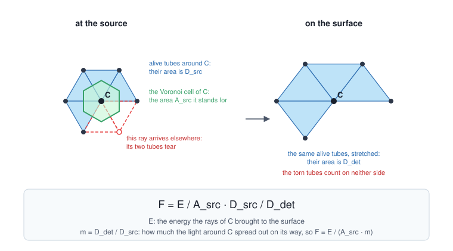
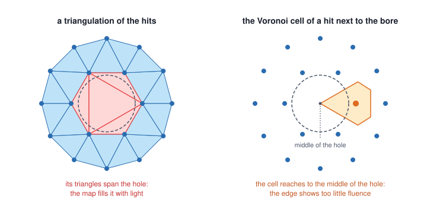
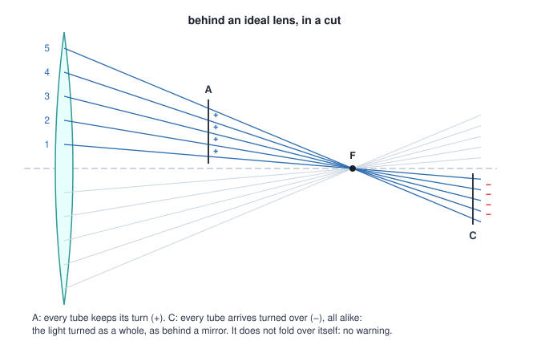

## Fluence 

In OPOSSUM, fluence describes the spatial distribution of optical energy deposited on a detector surface. It represents energy per unit area after the optical system has transformed the incoming beam.

Since ray tracing represents light using a finite number of rays, fluence must be reconstructed from discrete energy samples. Each ray carries a portion of energy and contributes to the detector at its intersection point. The reconstruction method defines how these discrete contributions are converted into a continuous fluence map.

This step is essential because quantities such as peak fluence, beam shape, and local intensity cannot be interpreted reliably from raw ray positions alone.

## Why Reconstruction is Needed

A straightforward approach is to divide the detector into a fixed grid and accumulate ray energy per cell. However, this introduces limitations. If the grid is too coarse, peak fluence is underestimated because energy is averaged over large areas. If the grid is too fine, the result becomes noisy unless a very large number of rays is used.

This creates a trade-off between spatial resolution and statistical stability. To address this, OPOSSUM provides multiple reconstruction methods that interpret the same ray data in different ways.

## Binning

The binning method divides the detector into a regular grid of square cells. Each ray contributes its energy to the cell where it lands, and fluence is computed as energy divided by cell area.

This method behaves like a pixelated representation of the detector. It is simple and computationally efficient, and it guarantees energy conservation within each cell.

However, the result strongly depends on grid resolution. A coarse grid smooths out details and can hide peak fluence regions, while a fine grid requires a high number of rays to avoid noise. As a result, binning is often used for fast but lower-resolution analysis.

Binning spreads the energy of plain rays. Rays with helper rays bring a fluence instead of an energy, so binning refuses them (see [Helper rays](#helper-rays)).

## Fluence from ray tubes

The Voronoi and the helper ray estimators follow the light from where it starts. At the source, every three neighboring rays span a triangle, a *ray tube*. The light inside a tube stays inside it: wherever its three rays go, the tube goes with them, stretched, shrunk or turned over.

On a surface, a tube is *alive* if all three of its rays arrived there. The map is drawn over the alive tubes only. A bore, an edge or an aperture that cuts the light tears the tubes across the cut: their rays arrive on different surfaces, and neither surface draws them. So where light was cut away, the map stays dark.

*The rays inside the bore pass it, the others are reflected. Each surface draws the tubes whose three rays all arrived there; the tubes across the edge of the bore are torn and drawn on neither.*

### The value at a corner

The Voronoi estimator spreads the energy `E` that the rays of a corner bring over the area `A_src` the corner stands for at the source: its Voronoi cell there, which gives the estimator its name. On the way, that area grows as much as the alive tubes around the corner grew:

`F = E / A_src · D_src / D_det`

where `D_src` and `D_det` are the areas of the alive tubes around the corner at the source and on the surface. A tube torn away counts on neither side, so a corner right next to a cut shows the fluence of the light that is there.

*`D_det / D_src` says how much the light around the corner spread out on its way. Rays with helper rays measure this themselves and bring their fluence along.*

Between its corners a tube runs linearly. Where tubes overlap, their values add up: two beams crossing each other, or light that folds over itself (see [Folds and caustics](#folds-and-caustics)).

### Edges

Beyond each edge that no alive tube continues, the map draws a margin of half a tube height, carrying the values of the edge across: the light ends somewhere inside the torn tube, halfway on average. The same rule holds at the outer edge of a beam and at a cut.

*The rays of the right column were cut away. The light ends somewhere in the torn tubes before them; the map assumes halfway and carries the edge values that far.*

Where an edge lies is therefore known only to half a tube. The report of a [fluence detector](../reference/nodes/fluence_detector.md) tells which share of the energy lies in these margins (`Energy in edge margins`). A large share means that the rays are too coarse for the edges of the light.

### Why the hits alone are not enough

A map built from the hits alone does not know which hits belonged together. A triangulation of the hits spans any hole between them, and the Voronoi cell of a hit next to a hole reaches into the hole. The map fills the hole with light, and next to it shows too little fluence, as the energy of the edge rays is spread over too large an area. The ray tubes know from the source which rays are neighbors, so a hole stays a hole.

### Sheets

Rays of one wavelength that start side by side form one *sheet*, triangulated by where they start. Rays that start at one point in different directions, as from a point source or from one pixel of an image source, form a sheet of their own, triangulated by their directions. Rays of different wavelengths never share a tube. Each sheet draws its own tubes, and the map is their sum.

### Folds and caustics

Near a caustic, light folds over itself: rays from one side of the beam cross rays from the other side, and the tubes beyond the crossing arrive turned over. Both layers of the light are drawn, and where they lie on top of each other their fluences add. At the fold itself, geometric optics fails: the fluence there would grow without bound, and the map cannot show its true value. The map then warns: "light folds over itself on this surface (caustic): the fluence near the fold is unreliable".

Light that turns over as a whole does not fold. Behind a clean focus, or after a mirror, every tube arrives turned over alike, and there is no warning. A tube squashed flat, as at a line focus, counts as neither turned nor kept, since rounding decides its side.

### When the tubes are built

A source spans the tubes only when an analysis needs them, since building them costs time and memory:

- a ghost focus analysis with the Voronoi or the helper ray estimator, and
- a ray tracing or ghost focus analysis whose model holds a fluence detector with one of these estimators, also inside a group.

The tubes are built on whatever the source sends out, raw rays included. The alignment run and the 3D view never build them.

### Limits

- A hole smaller than about two ray spacings is not resolved: no tube tears across it.
- A bundle with a gap already at the source, such as raw rays laid out as a ring, is bridged there: its tubes span the gap from the start.
- A ray all of whose tubes tore, such as a single stray ray, shows nowhere on the map.

## Helper rays

A ray can carry three helper rays very close to it, spanning a tiny triangle. The triangle stretches like the light around the ray, so on any surface it tells the fluence right at the ray: the energy of the triangle over its area. A source of rays with helper rays gives each ray the energy its fluence carries over the area the ray stands for in the ray tubes.

The helper ray estimator draws its map over the same ray tubes as the Voronoi estimator, with the fluence the helper rays measured at the corners. Holes and cuts therefore stay dark here as well. The peak fluence is the largest fluence the helper rays brought.

The helper rays of a ray tear when they do not all go its way, at the edge of a bore for instance; the ray then records no fluence from there on (see [Surface effects](./background/component_geometry.md#surface-effects)).

## KDE (Kernel Density Estimation)

The KDE method reconstructs fluence by treating each ray as a smooth energy distribution rather than a single point. Instead of assigning energy to a single location or cell, each ray spreads its energy over a surrounding area using a smooth kernel function.

The final fluence map is obtained by summing the contributions of all rays, resulting in a continuous and smooth intensity field.

The smoothing strength is controlled by the kernel width. If the width is too small, the result becomes noisy and resembles raw sampling. If it is too large, fine spatial details are lost and peak fluence can be reduced.

To balance this, the kernel width is typically chosen based on the density of samples using established statistical rules that adapt smoothing to the number and spread of rays.

This method provides the smoothest representation of fluence and is especially useful when a continuous interpretation of the beam profile is required. Like binning, it spreads the energy of plain rays and refuses rays with helper rays.

## Peak Fluence and Interpretation

Peak fluence represents the maximum energy concentration on the detector surface and is one of the most important quantities in optical system analysis.

It is sensitive to both sampling density and reconstruction method. Insufficient sampling can underestimate peak values, while excessive smoothing can reduce peak intensity. Conversely, coarse binning can either exaggerate or suppress peaks depending on grid alignment and resolution.

The methods do not hold the same energy either. Binning and KDE spread the energy of every ray that hit the surface. A map that follows ray tubes holds the energy of the tubes that arrived complete and of their margins: the margins estimate where the light ends, and a ray all of whose tubes tore shows nowhere.

For this reason, fluence reconstruction should always be interpreted together with ray density and system geometry.

## Key Takeaways

Fluence reconstruction converts discrete ray energy into a continuous spatial representation.

Binning uses fixed grid cells and is fast but resolution-dependent.

Voronoi and helper rays follow the ray tubes the source spans: holes and cuts stay dark, overlapping light adds up, and light folding over itself is warned about. An edge is known to half a tube.

KDE produces a smooth continuous distribution by spreading each ray’s energy over space.

The choice of method affects how clearly peak fluence and spatial energy distribution are represented, especially in systems with focused beams or non-uniform illumination.
