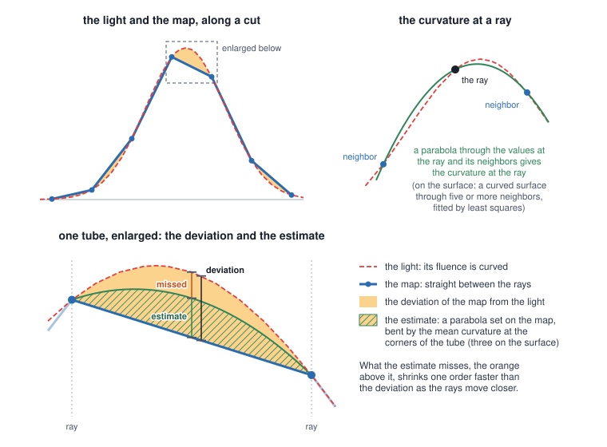

# Fluence uncertainty

This page explains where the error of a Voronoi fluence map, which follows the ray tubes of its source (see [Voronoi: fluence from ray tubes](../../concepts/fluence.md#voronoi-fluence-from-ray-tubes)), comes from, and how a [fluence detector](../nodes/fluence_detector.md) estimates it with its property `error estimates` switched on: the map `Fluence uncertainty` and the value `Peak fluence uncertainty`. [Fluence calculations](../../concepts/fluence.md#uncertainty) describes the same in words.

## In short

- The map knows the fluence at the rays and runs straight between them: in each ray tube it is the flat plane through the values at the three corners. A curved fluence bulges away from that plane. The gap grows with the curvature of the fluence and with the square of the spacing of the rays.
- At the peak of a Gaussian beam, with the rays $h$ apart, the map lies up to about $(h/\sigma)^2/6$ of the peak too low: 4 % for $h = \sigma/2$.
- OPOSSUM measures the curvature at every ray from the values of its neighbors and puts back the bulge the plane misses. That is `Fluence uncertainty`.
- What the estimate leaves is one power of the spacing smaller. Halving the spacing shrinks the gap about fourfold, and what the estimate leaves about eightfold. For a fluence shaped like a paraboloid, the estimate is exact.
- The peak of the map never lies above the real peak. `Peak fluence uncertainty` tells how far the real peak lies above it. It is an estimate, not a guaranteed bound.
- Not covered: the values at the rays themselves behind optics, the edges of the light, the outermost ring of a beam, folds and overlapping light, and anything finer than the spacing of the rays.

## Where the error comes from

*The figure from [Fluence calculations](../../concepts/fluence.md#uncertainty): a cut through a Gaussian beam, with rays one σ apart.*

### Between two rays

Take a cut through the light along one edge of a tube, from a ray at $x_0$ to a ray at $x_1 = x_0 + h$. The map draws the straight line $L$ through the fluence at the two rays. Subtract that line from the fluence $f$. What remains is zero at both rays, and it has the curvature $f''$ of the fluence, since a straight line has none. If the curvature is constant, the only such function is a parabola:

$$f(x) - L(x) = -\tfrac{1}{2}\, f''\,(x - x_0)(x_1 - x) .$$

The gap is largest in the middle of the tube, $-f''h^2/8$. Where the light bends down, as at a peak ($f'' < 0$), the map lies below it. Where the light bends up, as in the wings of a beam, the map lies above it. At the peak $f_\mathrm{peak}$ of a Gaussian beam, $f'' = -f_\mathrm{peak}/\sigma^2$, so along the cut the map lies up to $f_\mathrm{peak}\,h^2/(8\sigma^2)$ too low.

In a real beam the curvature changes a little across the tube, by about the third derivative times the spacing, $f''' h$. This adds a remainder of the order $f''' h^3$, one power of $h$ smaller than the gap. For a fluence shaped like a parabola it vanishes.

### In a tube

On the surface a tube is a triangle with the corners $x_0, x_1, x_2$, and the map is the flat plane through the fluence at the corners. Expand the fluence around a point $x$ of the tube: a constant, a slope, a curvature, and higher terms. A plane through three points reproduces the constant and the slope exactly. What it cannot follow is the curvature, so the gap is again set by the curvature. A short calculation sums it up edge by edge:

$$f(x) - L(x) \approx -\frac{1}{2}\sum_{i<j}\lambda_i\lambda_j\; e_{ij}^\top H\, e_{ij} .$$

Here $e_{ij} = x_i - x_j$ are the edges, $H$ is the curvature of the fluence, the matrix of its second derivatives, and $\lambda_i$ are the weights of the point between the corners (its barycentric coordinates). $\lambda_i$ is 1 at corner $i$, 0 on the edge opposite to it, and the three add up to 1. $e^\top H e$ is the curvature along an edge times its length squared. The weight $\lambda_i\lambda_j$ makes each edge count most in the middle of the tube and not at all at the corners. On an edge, where the third weight is 0, the sum is the cut above.

In the middle of a tube with three equal edges $h$, and a curvature that is the same in all directions, the sum gives $-f''h^2/6$. At the peak of a Gaussian beam, the map therefore lies up to $(h/\sigma)^2/6$ of the peak too low. It lies that low when the peak sits in the middle of a tube; when the peak sits right on a ray, the map gets it exactly. As before, the curvature changes across the tube, which adds a remainder of the order $f''' h^3$.

## Measuring the curvature

Between the rays the fluence is not known, and neither is its curvature. OPOSSUM measures it from the rays. At each ray, it fits a paraboloid through the values $F_k$ of its neighbors:

$$F_k - F_0 \approx g\cdot d_k + \tfrac{1}{2}\, d_k^\top \hat H\, d_k .$$

Here $F_0$ is the value at the ray, $d_k$ the step from the ray to its neighbor $k$, $g$ the slope and $\hat H$ the measured curvature. These are five unknowns, two slopes and three curvatures, so a ray needs at least five neighbors, which have to lie around it, not along a line. On a hexagonal grid a ray has six. The fit is least squares, and OPOSSUM measures no curvature at a ray whose neighbors pin the five unknowns down too weakly.

- If the fluence is a paraboloid, the fit matches it exactly: $\hat H = H$.
- Otherwise the third derivative bends the values of the neighbors away from the paraboloid, by about $f''' s^3$, where $s$ is the distance to the farthest neighbor. It takes a division by $s^2$ to turn values into a curvature, so the measured curvature is off by about $f''' s$. The factor in front depends on how well the neighbors surround the ray, not on how far apart they are.

## The estimate

In each tube, OPOSSUM takes the mean $\hat H_T$ of the curvatures measured at its corners and puts it into the formula of the gap:

$$\hat e(x) = -\frac{1}{2}\sum_{i<j}\lambda_i\lambda_j\; e_{ij}^\top \hat H_T\, e_{ij} .$$

Drawn onto the pixels of the map, this is `Fluence uncertainty`. Where tubes overlap, their estimates add up, as the map does.

The gap of the map is of the order $f'' h^2$. The estimate misses two things:

- the remainder of the formula, from the curvature changing across the tube, of the order $f''' h^3$;
- the error of the curvature it uses: the fit is off by about $f''' s$, and the curvature at the corners differs from that inside the tube by about $f''' h$. Both are multiplied by the $h^2$ of the formula.

So what the estimate leaves is of the order $f''' h^3$, one power of the spacing smaller than the gap. Halving the spacing of the rays shrinks the gap about fourfold, and what the estimate leaves about eightfold. For a Gaussian beam with σ = 2 mm, its peak 1 mm off the axis, sampled by hexapolar rings out to 8 mm:

| rings | ray spacing | largest gap of the map within 2σ | left after the estimate |
|------:|------------:|---------------------------------:|------------------------:|
|     7 |      1.1 mm |                      0.188 J/cm² |              0.040 J/cm² |
|    14 |     0.57 mm |                      0.062 J/cm² |             0.0044 J/cm² |
|    28 |     0.29 mm |                      0.018 J/cm² |             0.0006 J/cm² |

## The peak

The peak $P$ of the map is the highest of its pixels.

**The peak of the map never lies above the real peak.** Inside a tube, the plane is a weighted mean of the values at the three corners, so it never exceeds the largest of them, and those are values of the real fluence. The map can cut a peak off, but it cannot invent a higher one. This needs the values at the rays to be right, and each pixel to lie in one tube only (see the limits below).

**How far the real peak lies above.** The report gives the highest point of the map with the estimate added, minus the peak of the map, and never less than zero:

$$U = \max\big(L + \hat e\big) - P .$$

The real peak then lies about $U$ above the peak of the map:

$$P \;\le\; \text{real peak} \;\approx\; P + U .$$

The "about" is why $U$ is an estimate and not a bound. Two things remain: what the estimate leaves, of the order $f''' h^3$, and the pixels of the map. The real peak may lie between two pixels, where the map, even corrected, misses it by up to a quarter of the curvature times the squared pixel spacing.

For the Gaussian beam with 7 rings above, the peak of the map lies 0.187 J/cm² below that of the beam. $U$ = 0.148 J/cm² closes 79 % of that; 0.039 J/cm² remain.

## What the estimate rests on

- The fluence is smooth inside the alive tubes.
- The values at the rays are the real fluence there. Without optics between the source and the surface, this holds exactly, since an analysis gives each ray the value of its source's distribution times the area it stands for (see [The value at a corner](../../concepts/fluence.md#the-value-at-a-corner)). Behind optics it holds only approximately (see below).
- The light does not fold over itself on the surface (see [Folds and caustics](../../concepts/fluence.md#folds-and-caustics)).
- The light forms one sheet. Where sheets overlap, their maps add up, and their estimates with them.

## What it does not cover

- **The values at the rays behind optics.** A ray's value is divided by how much its tubes spread out on the way, $D_{det}/D_{src}$. That spread is averaged over the tubes around the ray, not taken at the ray itself. The resulting error is of the first order in $h$, and of the second where the tubes lie symmetrically around the ray. $U$ does not contain it.
- **The edges of the light.** Margins have no estimate, because the light ends there and is not smooth. Where it ends is known only to half a tube; `Energy in edge margins` tells how much energy lies in that uncertain strip.
- **The outermost ring of a beam.** A ray with fewer than five neighbors, or with neighbors that do not surround it, gets no curvature. Its tubes take the mean over their other corners, which are measured further inside. That can overshoot where the curvature changes fast, as at 7.5 mm in the cut under [Too few rays](../../concepts/fluence.md#too-few-rays). A tube with no measured corner has no estimate.
- **Folds and overlapping light.** Where the light folds over itself, where sheets overlap, or where a margin reaches across a gap narrower than a tube onto other light, the peak of the map can lie above the real peak.
- **Anything finer than the rays.** The estimate works if the light changes little from one ray to the next, that is, if $f''' h$ is small compared to $f''$. A structure narrower than the spacing of the rays does not show in their values, and no estimate built from them can see it.
- **Other estimators.** Only Voronoi maps get an estimate; KDE and binning report none.
