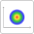

# Fluence detector

## Analysis

As a detector node, incoming light data is passed unmodified through the node. In a ray tracing or ghost focus analysis, the node records only the light within its `optic shape`: light outside its window passes on unrecorded, and the log and the report warn about it.

## Report

The report shows the fluence map, its peak fluence, the estimator and, as `Total energy`, the energy of the light that hit the detector, whatever the estimator. With the property `error estimates` switched on, it also tells, for Voronoi:

- `Energy in edge margins`: the share of the energy in the margins at the edges of the light, whose place is known only to half a ray tube.
- `Peak fluence uncertainty`: how far the peak of the fluence may lie above the peak of the map, estimated from the curvature of the fluence at the rays. The peak of the map never lies above that of the fluence, so the uncertainty points one way only. It is an estimate of the second order in the spacing of the rays, not a bound (see [Uncertainty](../../concepts/fluence.md#uncertainty), derived in [Fluence uncertainty](../derivations/fluence_uncertainty.md)).
- `Fluence uncertainty`: a map of the size of the estimated deviation of the fluence from the map at each point.
- `Energy deviation of the map`: the share by which the energy the map holds misses the energy that hit. Between its rays the map runs linearly, so a curved profile sampled by few rays, or much light at a cut edge, makes it miss. A large deviation shows that the rays are too coarse; a small one does not promise an exact peak, since the map lies low at a peak and high on its flanks, and the two partly cancel.

If the light folds over itself on the detector, as near a caustic, a warning in the log says that the fluence near the fold is unreliable. If the map cannot be computed, the report names the reason, for example rays that span no ray tubes on a Voronoi detector.

## Ports

`input_1`
: Input port.

`output_1`
: Light ouput. This port delivers a copy of the light data from the port `input_1`.

## Properties

`fluence estimator`
: The algorithm used to estimate the fluence. Currently there are the following options:

- Voronoi (default): follows the ray tubes the source spans (see [Voronoi: fluence from ray tubes](../../concepts/fluence.md#voronoi-fluence-from-ray-tubes)). Each corner spreads its energy over the area it stands for at the source, its Voronoi cell there, grown as much as its tubes grew on the way. Where light was cut away, as behind a bored mirror, the map stays dark.
- KDE: spreads the energy of each ray with a smooth kernel.
- Binning: spreads the energy of each ray over the four points of a grid around it.

Further information can be found [here](../../concepts/fluence.md)

`error estimates`
: Whether the report also tells how far the fluence may lie from the map: the four entries listed under [Report](#report), off by default. Estimating the curvature for the uncertainty fits a surface at every ray, so with the switch off the detector does not compute it at all.

`optic shape`
: The window the detector records within, a square of 25 mm × 25 mm by default. Set it to the size of the camera chip, or to `Open` to record all light. If the optical axis misses the window during the alignment run, a warning says that the measurement may fail (see [Optic shape](../nodes.md#optic-shape)).