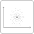

# Spot diagram

## Analysis

As a detector node, incoming light data is passed unmodified through the node. In a ray tracing or ghost focus analysis, the node records only the light within its `optic shape`: light outside its window passes on unrecorded, and the log and the report warn about it.

## Ports

`input_1`
: Input port.

`output_1`
: Light ouput. This port delivers a copy of the light data from the port `input_1`.

## Properties

`plot aperture`
: Boolean value. Outline the recording window (`optic shape`, unless it is `Open`) in the plot. Defaults to `false`.

`optic shape`
: The window the spot diagram records within, a square of 25 mm × 25 mm by default. Set it to the size of the camera chip, or to `Open` to record all light. If the optical axis misses the window during the alignment run, a warning says that the measurement may fail (see [Optic shape](../nodes.md#optic-shape)).
